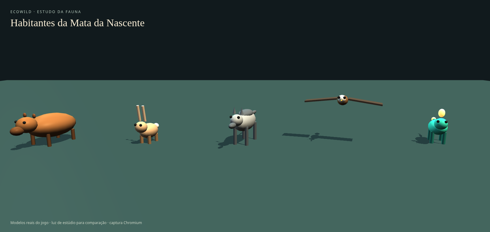
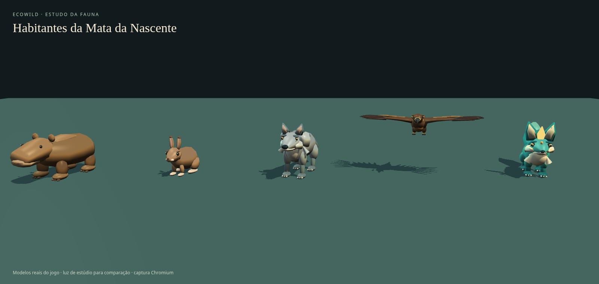
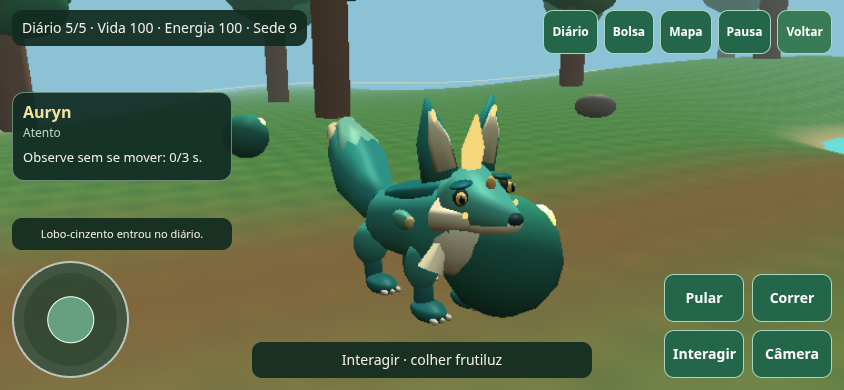

# Fauna, câmera e leitura dos encontros

Rodada na branch `feat/fauna-art-camera-bond`, partindo de `main@2cdacf763e82978bf673d03c3fba79c886d5ef19` após o merge do PR #5. Remoto conferido em 27/10/2026. O PR #4 já incorporou os 13 documentos de `chatgpt@a41adc7`/PR #3, com reconciliação manual. O PR #3 continua aberto/não mergeável; sua branch não foi alterada. Nenhum merge na main, force push, exclusão de branches ou deploy nesta rodada.

## Resultado visual

Comparação produzida no Chromium com os construtores reais do jogo, mesma câmera, luz de estúdio e chão. O estúdio serve à revisão da geometria; sua iluminação não é a da mata.

Antes (`main@2cdacf7`):

Depois:

Detalhes: [capivara](evidence/2026-10-27-fauna/capybara.png), [tapiti](evidence/2026-10-27-fauna/rabbit.png), [lobo](evidence/2026-10-27-fauna/wolf.png), [águia-real](evidence/2026-10-27-fauna/eagle.png) e [Auryn](evidence/2026-10-27-fauna/auryn.png).

## Diagnóstico e escopo

Já funcionavam na base: cinco espécies/11 atores, IA simples por espécie, movimento/colisões, coleta, diário gradual, vínculo completo da Auryn, FOLLOW/STAY/PROTECT/RETURN, save v1, backup/exportação/recuperação, proteção entre abas, toque independente/pinça e PWA offline. Esses sistemas foram preservados; não foi criada outra fundação, sexta espécie ou segunda criatura fantástica.

| Prioridade | Caminho e evidência anterior | Mudança e evidência atual |
|---|---|---|
| P2 — apresentação | `render/actors.ts`: corpos de poucas primitivas, pernas retas, pouca anatomia e asas simples; animação genérica | Cinco construtores separados, seções esculpidas e detalhes próprios; capturas comparáveis e bounds/recursos testados |
| P1 — câmera | `EcoWildGame.cameraClearance`: aproximação por círculos planos não distinguia copa de rocha baixa; interpolação de posição podia cortar obstáculos | `camera/boom.ts` resolve segmento em volumes 3D e terreno; recuo imediato/extensão suave; testes de copa, tronco, rocha e giro, mais árvore real no Chromium |
| P2 — encontro | Sem enquadramento contextual para inspecionar os animais | Q/Observar com giro/zoom, nota lateral, saída por movimento e restauração da vista anterior; simulação continua |
| P2 — feedback | Durante a revisão, a nova nota mandava esperar fora do alcance de observação/confiança | Limites compartilhados com a simulação e instrução de aproximação; regressões nos limites de 5,5/5,4 m |
| P2 — feedback | Durante a revisão, nota pronta podia prometer oferta quando E priorizava um recurso | `encounterNote` consulta `interactionTarget`; orienta colher/afastar-se primeiro; teste de coleta → oferta |

Não foi identificado novo defeito P0 de persistência nesta rodada. Percepção rigorosa, navegação avançada, LOD, novos biomas e domesticação de outra espécie continuam fora deste recorte.

## Implementação

- **Arte:** capivara com corpo volumoso/focinho largo/orelhas altas; tapiti marrom com patas posteriores e orelhas curtas; lobo com ombros, focinho, rufos e cauda; águia-real marrom/dourada com bico curvo, penas e garras; Auryn verde-petróleo/creme/dourado, orelhas foliares, cauda e crista luminosa. Geometria própria, sem modelo/textura externo ou dependência nova.
- **Animação:** respiração, marcha, salto do tapiti, cabeça abaixada ao comer/beber, repouso, orelhas em medo, cauda amistosa da Auryn vinculada e voo alternando planagem/batidas. Articulações locais recebem o estado existente; a raiz segue exatamente a posição/rotação da simulação. Não há IK ou animação esquelética.
- **Câmera:** volumes estáticos acompanham as dimensões visíveis de troncos/copas/rochas. Terreno é amostrado; aproximação recua imediatamente, extensão suaviza a distância sobre a órbita atual. Primeira pessoa, sensibilidade e zoom por pinça continuam disponíveis.
- **Observação/vínculo:** foco em indivíduo já conhecido até 8 m e acompanhamento até 12 m, com bloqueio aproximado por cenário. O jogador fica oculto nesse enquadramento para não tapar o animal. Mover/pular/Q/V encerra e restaura a vista. A nota reflete estado, calma, alcance, tempo observado, confiança, fruto e ação real. Nenhum item, descoberta ou vínculo é concedido pela câmera. Menus pausam; o foco sozinho não pausa nem impede ataques.
- **Compatibilidade:** IDs de espécies/instâncias, nome Auryn e SaveV1 mantidos. `representation: procedural-stylized-v2` é metadado visual, não uma nova versão de save. Preferências/progresso continuam separados. Nenhum dado local é apagado pela atualização.

## Custo medido

Contagem dos modelos isolados, sem o chão do estúdio:

| Espécie | Meshes antes → depois | Triângulos antes → depois |
|---|---:|---:|
| Capivara | 11 → 8 | 2.348 → 4.896 |
| Tapiti | 11 → 9 | 1.740 → 4.616 |
| Lobo | 13 → 9 | 2.380 → 6.144 |
| Águia-real | 8 → 5 | 1.660 → 6.408 |
| Auryn | 12 → 14 | 2.672 → 7.232 |

Cena completa: **154 → 128 meshes; 40 → 24 materiais**. Peças estáticas são mescladas por articulação e as cinco espécies compartilham dois materiais com cores por vértice. A Auryn usa peças luminosas adicionais. Animações e troca de qualidade não aumentaram as contagens nos roteiros. Isso mede recursos, não draw calls efetivos nem ausência de alocações JavaScript.

Há mais triângulos para melhorar a forma. O teste impõe menos de 8.000 por espécie, mas esse teto não comprova desempenho em celular. A sondagem em `mobile.json` registrou média de **12,1 FPS** em dez amostras ao longo de cinco segundos, 844×390, qualidade baixa, Chromium headless/SwiftShader. Não é benchmark de GPU física, comparação controlada de FPS com a base ou comprovação das metas de 30/60 FPS.

## Validação

Ambiente: Linux, Python 3.12.14, Playwright 1.62.0, Chromium 154.0.8037.57 e SwiftShader. Comandos reproduzíveis em [TESTING.md](TESTING.md); [resultados e capturas](evidence/2026-10-27-fauna/).

| Check | Resultado |
|---|---|
| `npm run typecheck` | Passou |
| `npm test` | 50 testes em 10 arquivos passaram; base tinha 36 em sete |
| `npm run build` | Passou: 1.938 módulos, principal 5.184,89 kB / gzip 1.163,51 kB; aviso conhecido >500 kB permanece |
| `git diff --check` | Passou |
| `fauna-check.py --ref 2cdacf7` e versão atual | Cinco espécies, perfil/três quartos, poses, bounds finitos e contagens estáveis; sem pageerrors |
| `encounter-check.py` | Botão/Q, saída por movimento, pausa, primeira/terceira pessoa, sem vínculo automático, árvore real; distância recuou de 6,4 m desejados para 1,514 m; sem pageerrors |
| `playthrough-check.py` | Teclas reais desde spawn, coleta, observação da Auryn móvel, oferta/vínculo, STAY/nome Luz, save/reload, diário 100%; sem editar simulação nem pageerrors |
| `browser-check.py` | Toque simultâneo, liberação/cancelamento/blur, quatro viewports, preferências, comandos, IndexedDB e contexto WebGL; resultados em `mobile.json` |
| `recovery-check.py` | Exportação/restauração/desfazer, versão desconhecida, backup inválido, rollback, conflito persistente entre abas e três dedos com pinça; resultados em `recovery.json` |
| `pwa-check.py` | Produção sob `/ecowild/`: manifest/ícones, installability CDP sem erros, offline com save, atualização bloqueada por outra aba e offline após retirar JS antigo do servidor temporário; sem pageerrors |

Precache de produção: 17 arquivos locais, **5.223.162 bytes**, abaixo de 8 MiB. As capturas/documentos não entram no bundle nem no precache. Não houve publicação de produção ou instalação pelo sistema operacional.

O roteiro de vínculo inicialmente esgotou 45 segundos reais; o diagnóstico registrou apenas 10,7 segundos de simulação nessa fase, observação crescente e confiança 26, sem erro de runtime. O roteiro agora usa prazo lógico com guarda real e salva trace/captura em falha, mantendo as exigências do vínculo. A execução aprovada levou 7,72 segundos simulados/27,65 reais nessa fase, com IA móvel e sem fixture. O estúdio também recebeu correção de URL absoluta no módulo Blob da comparação histórica; isso era infraestrutura do teste, não código do jogo. Não foram relaxados asserts para ocultar falhas.

## Limites e próximos passos

1. `render/creatures/animate.ts`: poses aproximadas, sem IK/contato de cada pata em declive, animação esquelética ou LOD. Próximo refinamento deve medir custo e melhorar contato/transições.
2. `camera/boom.ts` e `worldVolumes.ts`: volumes conservadores, não triângulos; arbustos/animais não bloqueiam câmera. Pivô dentro de volume retrai ao próprio pivô. Manter volumes coerentes se a floresta mudar.
3. `sim/simulation.ts`: IA/diário ainda usam proximidade, sem visão rigorosa/cone/memória; navegação local e recuperação de pet continuam simplificadas. O foco da câmera não resolve esses sistemas.
4. `performance/quality.ts`/build: validar FPS/frame time e memória em hardware e revisar importações Babylon; bundle grande permanece. Sem teste físico iPhone/Safari, Android/Chrome ou gamepad, nem instalação/standalone pelo SO.
5. `persistence/`: proteção entre sessões desta versão permanece; abas antigas devem ser fechadas. Importação de JSON é futura. O repositório não recebeu migração de save nesta rodada.
